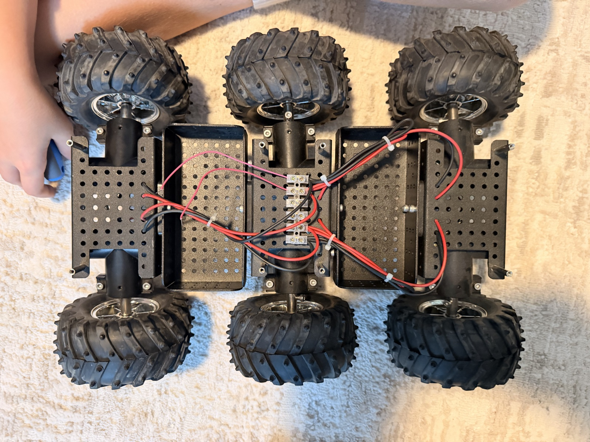

# Mars Rover 🚀

A parent-and-kid project: a six-wheeled Mars-style rover built on a DAGU Wild Thumper 6WD chassis, driven by a Raspberry Pi Pico and controlled with an Xbox controller through an iPhone.



## Phases

| Phase | Goal | Status |
|---|---|---|
| **1. Drive** | Pico drives both sides of the rover; Xbox controller → iPhone → Mac → Pico (USB) | 🚗 Drives from the Mac |
| **2. Wireless** | Swap in a wireless Pico (Pico 2 W) so the iPhone talks to the rover directly; Pico powered from the battery | ⏳ Planned |
| **3. Payload** | Add things on top (e.g. a robotic arm) controlled by the Pico and the Xbox controller | ⏳ Planned |

## What's here

| Document | What it covers |
|---|---|
| [Architecture](docs/architecture.md) | How the pieces talk to each other, per phase |
| [Bill of materials](docs/bom.md) | Every part, why we picked it, and its status |
| [Wiring](docs/wiring.md) | Wiring diagram and Pico pinout |
| [Power & LiPo safety](docs/power-and-safety.md) | Battery rules, fuse, switch, alarm, and why they matter |
| [Build log](docs/build-log.md) | Dated diary of what we did, with photos |

## Repository layout

```
├── README.md
├── docs/                 # documentation + photos
├── hardware/wiring/      # WireViz source (rover.yml) and rendered diagrams
├── firmware/             # MicroPython for the Pico (main.py, motor_test.py)
├── mac/                  # Drive from the Mac with an Xbox controller
└── app/ios/              # iPhone app + Xbox controller      (coming soon)
```

## Driving

1. **Pair the Xbox controller with the Mac** (System Settings → Bluetooth; hold the controller's pair button until the Xbox logo flashes fast), or plug it in with a USB-C cable.
2. Plug the Pico into the Mac, then plug in the battery.
3. Run:

```bash
pip install -r mac/requirements.txt
python mac/drive.py
```

| Control | Does |
|---|---|
| Left stick up/down | Forward / backward (50 % max) |
| Right stick left/right | Turn |
| Hold **RB** | Turbo (100 %) |
| Hold **B** | Stop |

Ctrl-C quits. If the script stops or the cable comes out, the Pico stops the motors within 0.3 s.

### Updating the Pico

[`firmware/main.py`](firmware/main.py) runs on every power-up. To change it:

```bash
pip install mpremote
mpremote cp firmware/main.py :main.py
mpremote reset
```

`mpremote` stops the running `main.py` while it works; `mpremote reset` starts it again.

## Rendering the wiring diagram

The wiring diagram is written as text in [`hardware/wiring/rover.yml`](hardware/wiring/rover.yml) using [WireViz](https://github.com/wireviz/WireViz). After editing it, regenerate the images:

```bash
brew install graphviz
pip install wireviz
wireviz hardware/wiring/rover.yml
```
