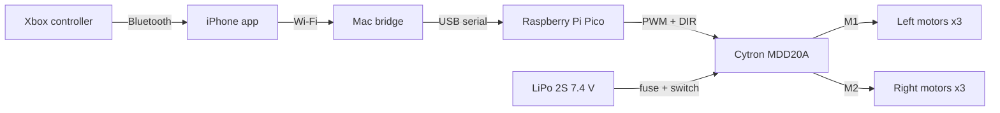
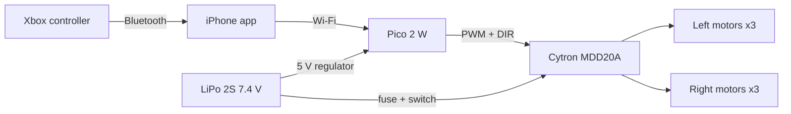
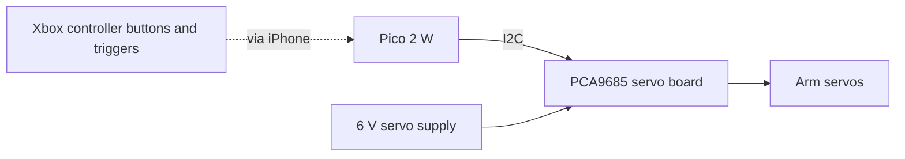
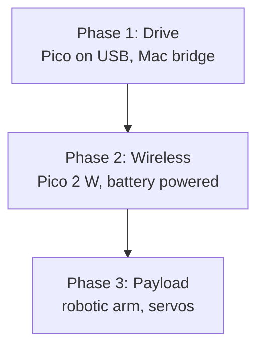

# Architecture

The rover is a "tank-steered" vehicle: the three motors on each side are wired in parallel, so the Pico only controls two things — **left side speed/direction** and **right side speed/direction**. Turning means driving the sides at different speeds (or opposite directions to spin in place).

## Phase 1 — Drive (Pico tethered to the Mac)

The Pico has no wireless yet, so the Mac acts as the bridge between the iPhone and the Pico.



- **Xbox → iPhone:** iOS supports Xbox controllers natively over Bluetooth.
- **iPhone → Mac:** a small app reads the sticks and sends drive commands over the home Wi-Fi.
- **Mac → Pico:** a small program on the Mac forwards the commands over the USB cable, which also powers the Pico.
- **Pico → motors:** the Pico sets a speed (PWM) and direction (DIR) for each side on the MDD20A motor driver.

### Drive commands

A simple text line, sent 20–50 times per second:

```
D <left> <right>      # each from -100 (full reverse) to 100 (full forward)
```

**Safety rule:** if the Pico hears nothing for 300 ms, it stops both motors. A dropped connection must never leave the rover driving.

## Phase 2 — Wireless

Replace the Pico with a **Pico 2 W** (same pins, adds Wi-Fi and Bluetooth). The Mac drops out; the iPhone talks to the rover directly using the same `D <left> <right>` commands. The Pico gets its power from the battery through a 5 V regulator.



Extras planned for this phase:
- Battery voltage reading on the Pico, with automatic slow-down and shutoff on low battery.
- Headlights (WS2812 LED strip) and a horn (buzzer) from the Thales kit.

## Phase 3 — Payload (e.g. robotic arm)

Servos for an arm need their own power supply — they can draw several amps, which would reset the Pico if shared.



## Phase overview


