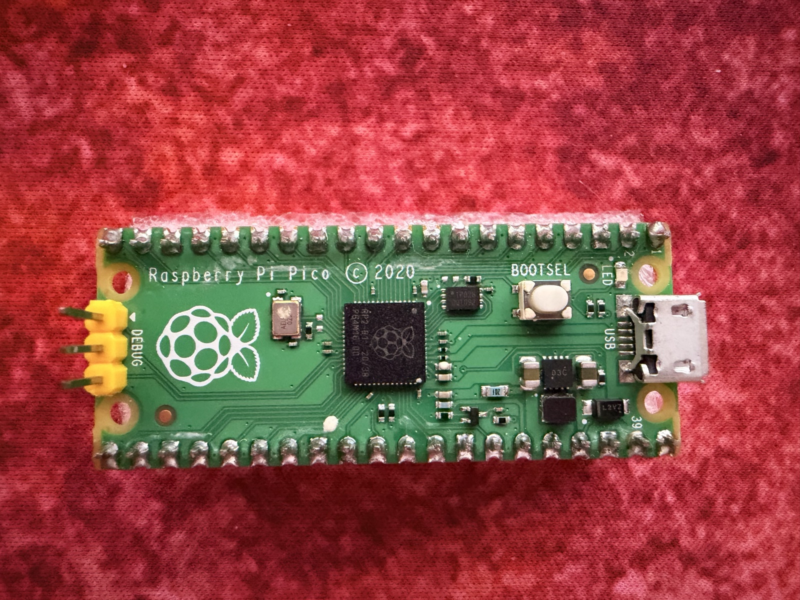
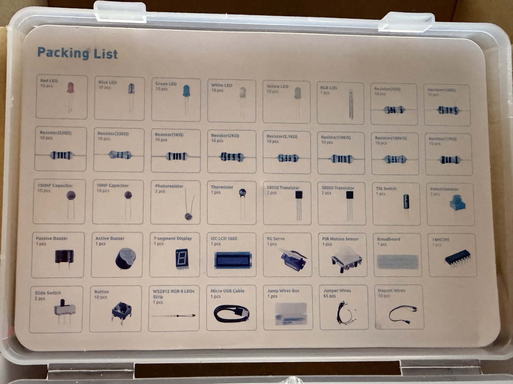
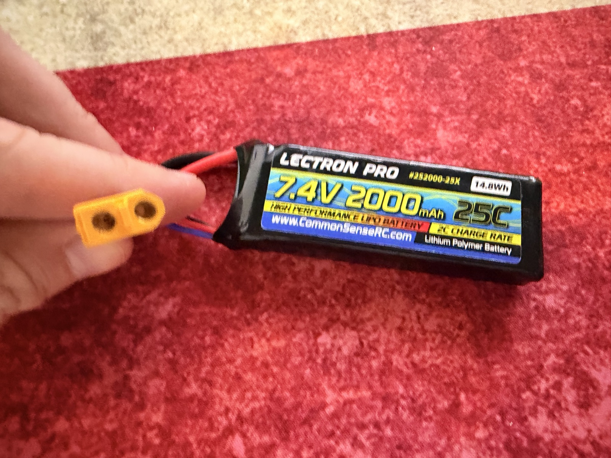
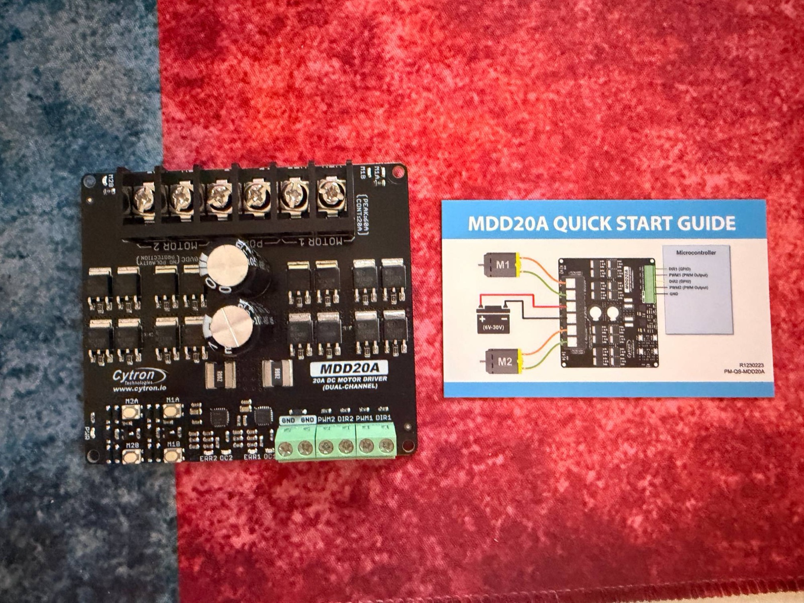

# Build log

## 2026-10-17 — Taking stock

We gathered what we already have: a Raspberry Pi Pico (headers already soldered) and the SunFounder Thales electronics kit.

## 2026-10-18 — First drive and choosing parts

The DAGU Wild Thumper 6WD chassis is assembled. Each of the six wheels has its own motor; the three motors on each side are wired together on a terminal strip in the middle. We connected the 2S LiPo battery directly and the rover started moving nicely!

Things we noticed:
- Some wires loop loosely over the battery trays and chassis joints — they need tidying so they can't get pinched.
- One left-side wire looks pinker than the others; worth checking it's connected to the right motor terminal.
- We should check that all three wheels on each side spin the same way.

Then we picked and ordered the parts for Phase 1 (see the [bill of materials](bom.md)):
- **Cytron MDD20A** motor driver — because three stuck motors on one side can pull ~20 A.
- **20 A fuse**, **XT60 connector** and **Pololu power switch** — so the LiPo can't hurt anything.
- **LiPo alarm** — so we never run the battery flat.

Next: wait for parts, plan the wiring ([wiring](wiring.md)), and start writing the Pico code.

## 2026-10-31 — Parts arrived

Everything is here except the power switch (still backordered), so the XT60 plug is our on/off switch for now.

The MDD20A motor driver has handy extras: **test buttons** to spin each motor without any code, error/over-current LEDs, and the truth table printed right on the back. Its control inputs are a green screw terminal rather than pins. We updated the [wiring diagrams](wiring.md) with the exact labels from the board.

Next: wire it up following the [wiring order](wiring.md#wiring-order), test each side with the buttons, then write the first Pico program.

## 2026-10-31 — Wired up and first code-driven spin

We soldered the XT60 and wired everything following the wiring order. The test buttons showed M1A and M2A spinning opposite ways: the right-side motors are mirrored, so we swapped the right side's wires (M2A ↔ M2B). Now "A" is forward on both sides.

The Pico got a safe-boot [`main.py`](../firmware/main.py) that holds the motors stopped at power-up. Then the [slow motor test](../firmware/motor_test.py) ran each side forward and back at 30 % from the Mac: all correct!

Next: drive firmware (`D <left> <right>` commands with a stop-if-silent watchdog) and driving it from the Mac with the Xbox controller.
