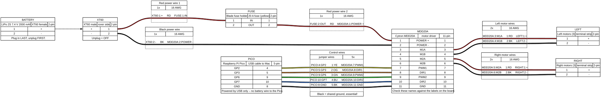
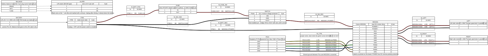

# Wiring

## Build now (power switch not here yet)



Source: [`hardware/wiring/rover-build-now.yml`](../hardware/wiring/rover-build-now.yml). The XT60 plug is the on/off switch until the power switch arrives.

### Wiring order

1. **Battery unplugged** the whole time.
2. **Motors → driver:** left terminal strip → M1A/M1B, right terminal strip → M2A/M2B (16 AWG).
3. **Black power wire:** XT60 − → driver POWER −.
4. **Red power wires:** XT60 + → fuse holder → driver POWER +. Fuse **out** of the holder for now.
5. **Control wires:** Pico GP2, GP3, GP6, GP7, GND → driver PWM1, DIR1, PWM2, DIR2, GND.
6. **Check:** red goes only to "+", black only to "−", no bare wire touching the metal chassis.
7. **Lift the wheels off the table**, put the 20 A fuse in, plug in the battery.
8. Use the driver's **test buttons** (labelled M1A/M1B/M2A/M2B on the board, if present) to spin each side. If a side spins backwards, swap that side's two motor wires.

## Final Phase 1 wiring (with power switch)



Source: [`hardware/wiring/rover.yml`](../hardware/wiring/rover.yml) (WireViz). Edit the YAML and re-run `wireviz hardware/wiring/rover.yml` to update the picture.

> ⚠️ The MDD20A terminal names are from its documentation; check them against the labels printed on the real board before connecting the battery.

## Power path

```
LiPo ─ XT60 ─ 20 A fuse ─ power switch ─ MDD20A B+
LiPo − ──────────────────────────────── MDD20A B−
```

- Until the Pololu switch arrives, there is a plain wire where the switch goes and **the XT60 plug is the on/off switch**.
- Use 16 AWG wire for everything that carries motor current.
- Put the fuse as close to the battery connector as possible.

## Motors

The three motors on each side are already joined on the terminal strip in the middle of the chassis.

| MDD20A terminal | Goes to |
|---|---|
| M1A / M1B | Left side motors (+ / −) |
| M2A / M2B | Right side motors (+ / −) |

If one side drives backwards, swap that side's two wires — or flip it in software.

## Pico → MDD20A (control)

| Signal | Pico pin (GPIO) | Pico physical pin | MDD20A pin | Wire colour |
|---|---|---|---|---|
| Left speed | GP2 | 4 | PWM1 | yellow |
| Left direction | GP3 | 5 | DIR1 | orange |
| Right speed | GP6 | 9 | PWM2 | green |
| Right direction | GP7 | 10 | DIR2 | blue |
| Ground | GND | 8 | GND | black |

**The ground wire is essential.** Without a shared ground the driver can't read the Pico's signals.

In Phase 1 the Pico is powered by the USB cable from the Mac — do **not** connect battery power to the Pico.

## Test inputs from the Thales kit

| What | Pico pin | Wiring |
|---|---|---|
| Potentiometer (manual speed test) | GP27 / ADC1 (pin 32) | Outer legs to 3V3 (pin 36) and AGND (pin 33), middle leg to GP27 |

## Battery voltage sense (Phase 2)

A voltage divider brings the battery voltage (max 8.4 V) down to a safe level for the Pico's 3.3 V input:

```
Battery + ── 10 kΩ ── 10 kΩ ──┬── GP26 / ADC0 (pin 31)
                              │
                            10 kΩ
                              │
Battery − ────────────────────┴── AGND (pin 33)
```

8.4 V × 10 / 30 = **2.8 V** at the pin. In code: `battery_volts = adc_volts × 3`.

## Pin plan (all phases)

| Pico pin | Use | Phase |
|---|---|---|
| GP2, GP3 | Left motors PWM, DIR | 1 |
| GP6, GP7 | Right motors PWM, DIR | 1 |
| GP27 / ADC1 | Potentiometer test | 1 |
| GP26 / ADC0 | Battery voltage | 2 |
| GP15 | Power switch OFF pin (low-battery shutoff) | 2 |
| GP4, GP5 | I2C (LCD1602, PCA9685 servo board) | 2–3 |
| GP16 | WS2812 lights | 2 |
| GP14 | Buzzer (horn) | 2 |
