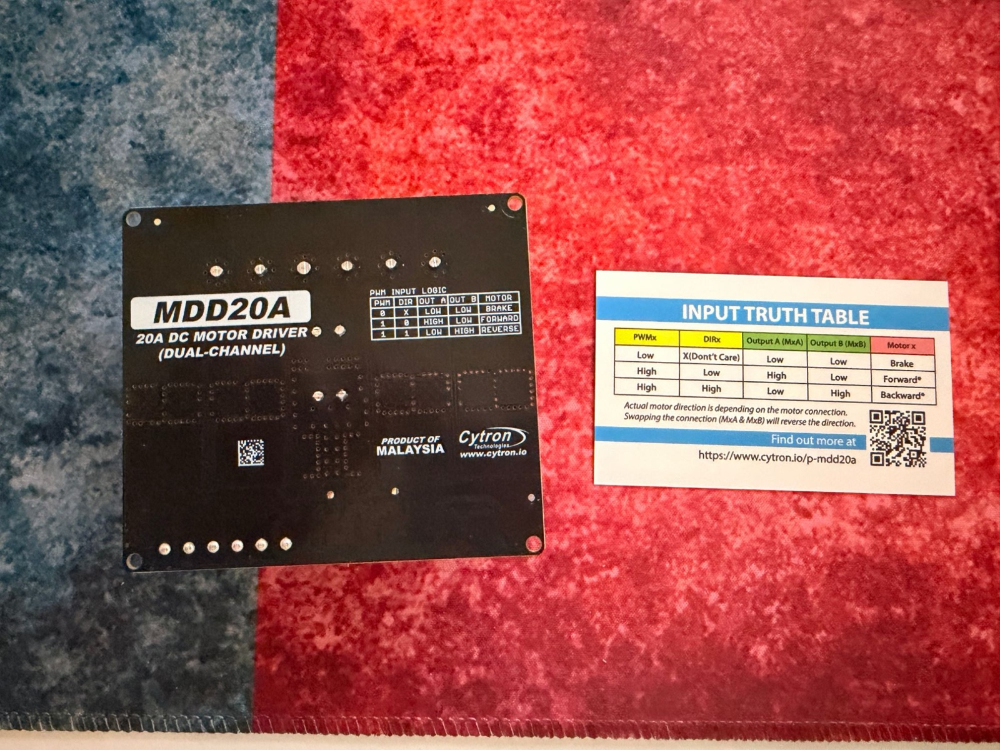

# Wiring

## Build now (power switch not here yet)


Source: [`hardware/wiring/rover-build-now.yml`](../hardware/wiring/rover-build-now.yml). The XT60 plug is the on/off switch until the power switch arrives.

### Wiring order

1. **Battery unplugged** the whole time.
2. **Motors → driver:** left terminal strip → M1A/M1B, right terminal strip → M2A/M2B (16 AWG).
3. **Black power wire:** XT60 − → driver POWER −.
4. **Red power wires:** XT60 + → fuse holder → driver POWER +. Fuse **out** of the holder for now.
5. **Control wires:** Pico GP2, GP3, GP6, GP7, GND → driver PWM1, DIR1, PWM2, DIR2, GND. The driver's control inputs are a **green screw terminal**, not pins: strip the wire ends (or cut a jumper wire and strip it) and screw them in.
6. **Check:** red goes only to "+", black only to "−", no bare wire touching the metal chassis.
7. **Lift the wheels off the table**, put the 20 A fuse in, plug in the battery.
8. Press the driver's **test buttons** (M1A, M1B, M2A, M2B, bottom-left of the board) to spin each side. If a side spins backwards, swap that side's two motor wires.

## Final Phase 1 wiring (with power switch)


Source: [`hardware/wiring/rover.yml`](../hardware/wiring/rover.yml) (WireViz). Edit the YAML and re-run `wireviz hardware/wiring/rover.yml` to update the picture.

## The MDD20A board


| Where on the board | Terminals (left → right, as in the photo above) |
|---|---|
| Big black screw terminal (top) | **MOTOR 2** (M2B, M2A) · **POWER** (−, +) · **MOTOR 1** (M1B, M1A) |
| Green screw terminal (bottom right) | GND · GND · PWM2 · DIR2 · PWM1 · DIR1 |
| Buttons (bottom left) | M1A, M1B, M2A, M2B: spin a motor without any code |
| LEDs | PWR, ERR1/ERR2 (error), OC1/OC2 (over-current) |

> ⚠️ The board says **"NO POLARITY PROTECTION"** next to POWER. Read the **+** and **−** marks printed by the POWER screws before connecting, and double-check red goes to **+**. Per the quick start card, + is the POWER screw next to MOTOR 1.

### Truth table (printed on the back)



| PWM | DIR | Output A | Output B | Motor |
|---|---|---|---|---|
| Low | any | Low | Low | **Brake** |
| High | Low | High | Low | Forward |
| High | High | Low | High | Backward |

So in code: DIR picks the direction, PWM duty cycle (0–100 %) sets the speed, and PWM 0 brakes.

## Power path

```
LiPo ─ XT60 ─ 20 A fuse ─ power switch ─ MDD20A POWER +
LiPo − ──────────────────────────────── MDD20A POWER −
```

- Until the Pololu switch arrives, there is a plain wire where the switch goes and **the XT60 plug is the on/off switch**.
- Use 16 AWG wire for everything that carries motor current.
- Put the fuse as close to the battery connector as possible.

## LiPo alarm

The alarm plugs into the battery's **balance lead** (the small white 3-pin plug), not into the power wiring. It shows the voltage and beeps when a cell gets low.

- The alarm has 9 pins, marked **−, 1S … 8S**. A 2S battery uses only the bottom three: **−, 1S, 2S**.
- Plug the balance lead on so its **black wire is on the "−" pin** (the end marked with a minus).
- Press the button to cycle the display and set the alarm. The factory setting is 3.3 V; set it to **3.5 V**.
- Unplug it after driving: it slowly drains the battery.

## Motors

The three motors on each side are already joined on the terminal strip in the middle of the chassis.

| MDD20A terminal | Goes to |
|---|---|
| M1A / M1B | Left side motors (+ / −) |
| M2A / M2B | Right side motors (− / +): **crossed on purpose**, the right motors face the other way |

The right side is wired crossed because its motors are mirrored. Check: the test buttons M1A and M2A should both spin the wheels forward.

## Pico → MDD20A (control)

| Signal | Pico pin (GPIO) | Pico physical pin | MDD20A pin | Wire colour |
|---|---|---|---|---|
| Left speed | GP2 | 4 | PWM1 | yellow |
| Left direction | GP3 | 5 | DIR1 | orange |
| Right speed | GP6 | 9 | PWM2 | green |
| Right direction | GP7 | 10 | DIR2 | blue |
| Ground | GND | 8 | GND | black |

**The ground wire is essential.** Without a shared ground the driver can't read the Pico's signals.

In Phase 1 the Pico is powered by the USB cable from the Mac — do **not** connect battery power to the Pico.

## Test inputs from the Thales kit

| What | Pico pin | Wiring |
|---|---|---|
| Potentiometer (manual speed test) | GP27 / ADC1 (pin 32) | Outer legs to 3V3 (pin 36) and AGND (pin 33), middle leg to GP27 |

## Battery voltage sense (Phase 2)

A voltage divider brings the battery voltage (max 8.4 V) down to a safe level for the Pico's 3.3 V input:

```
Battery + ── 10 kΩ ── 10 kΩ ──┬── GP26 / ADC0 (pin 31)
                              │
                            10 kΩ
                              │
Battery − ────────────────────┴── AGND (pin 33)
```

8.4 V × 10 / 30 = **2.8 V** at the pin. In code: `battery_volts = adc_volts × 3`.

## Pin plan (all phases)

| Pico pin | Use | Phase |
|---|---|---|
| GP2, GP3 | Left motors PWM, DIR | 1 |
| GP6, GP7 | Right motors PWM, DIR | 1 |
| GP27 / ADC1 | Potentiometer test | 1 |
| GP26 / ADC0 | Battery voltage | 2 |
| GP15 | Power switch OFF pin (low-battery shutoff) | 2 |
| GP4, GP5 | I2C (LCD1602, PCA9685 servo board) | 2–3 |
| GP16 | WS2812 lights | 2 |
| GP14 | Buzzer (horn) | 2 |
